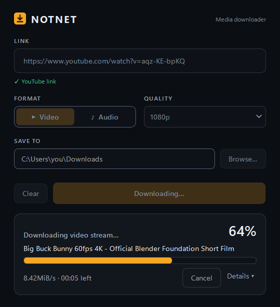

<div align="center">


# NOTNET

**Download video and audio from YouTube, TikTok, Instagram, Facebook, X and hundreds of other sites, as MP4 or MP3.**<br>
A small Windows app powered by [yt-dlp](https://github.com/yt-dlp/yt-dlp) and FFmpeg.


[Features](#features) • [Getting started](#getting-started) • [Usage](#usage) • [Development](#development) • [Troubleshooting](#troubleshooting)



</div>

Paste a link, pick **Video (MP4)** or **Audio (MP3)**, and press Download. NOTNET picks the best stream, merges or converts it with FFmpeg, and saves the file to your folder. The same engine is also available as a command-line tool and a small local HTTP API.

## Features

- **Hundreds of sites**: YouTube, TikTok, Instagram, Facebook, X and almost any site [yt-dlp supports](https://github.com/yt-dlp/yt-dlp/blob/master/supportedsites.md).
- **Real `.mp4` video** at the quality you choose (best available or 1080p down to 360p), and **MP3 audio** at 192 kbps.
- **Link detection**: the app recognizes the platform as you paste, and completes links copied without `https://`.
- **Clear progress**: stage, title, percentage, speed and time left, without freezing the window.
- **Faster downloads** on HLS/DASH sites such as X, Instagram and Facebook, by downloading 4 fragments in parallel.
- **Cancel anytime** with **Cancel** or <kbd>Esc</kbd>; partial files are cleaned up.
- **Plain-language errors**, with the full log one click away in **Details**.
- **Remembers your choices**: folder, format and quality persist between sessions.
- **Portable**: unzip and run, nothing to install, and FFmpeg is included. The window opens in under a second.

## Getting started

### Download the app

1. Download `notnet-<version>-win64.zip` from the [Releases](https://github.com/Natanmiuz/mp3-mp4-downloader/releases) page.
2. Extract it anywhere, for example in your Documents folder.
3. Run `notnet\notnet.exe`.

> [!IMPORTANT]
> Keep the `_internal` folder next to `notnet.exe`. It contains Python, Qt and FFmpeg, and the app won't start without it.

### Run from source

You need [Python 3.13](https://www.python.org/downloads/) and an FFmpeg build for Windows, such as the ones linked from [ffmpeg.org](https://ffmpeg.org/download.html).

1. Clone the repository and install the dependencies:

   ```powershell
   git clone https://github.com/Natanmiuz/mp3-mp4-downloader.git
   cd mp3-mp4-downloader
   python -m venv venv
   venv\Scripts\activate
   pip install -r requirements.txt
   ```

2. Copy `ffmpeg.exe` into a `binaries` folder at the repository root, so you have `binaries\ffmpeg.exe`. It isn't stored in the repository.
3. Start the app:

   ```powershell
   python main.py
   ```

## Usage

### Desktop app

1. Paste a link. The line below the field confirms the platform, or tells you if the text isn't a link.
2. Choose **Video** or **Audio**. For video, you can also pick a quality.
3. Check **Save to** (your Downloads folder by default), or click **Browse…** to change it.
4. Press **Download** or <kbd>Enter</kbd>. Press **Cancel** or <kbd>Esc</kbd> to stop.
5. When it finishes, click **Show in folder** to open the file's location.

### Command line

```powershell
python cli\main_cli.py <URL> [-f mp3|mp4] [-o FOLDER] [--ffmpeg PATH]
```

| Option | Description | Default |
|---|---|---|
| `URL` | Link to download. If you leave it out, the CLI asks for it. | — |
| `-f`, `--format` | `mp4` for video or `mp3` for audio. | `mp4` |
| `-o`, `--output` | Output folder. | `./descargas` |
| `--ffmpeg` | Path to `ffmpeg.exe`. | `ffmpeg` on your `PATH` |

```powershell
python cli\main_cli.py "https://www.youtube.com/watch?v=aqz-KE-bpKQ" -f mp3 --ffmpeg binaries\ffmpeg.exe
```

> [!NOTE]
> The command line prints its messages in Spanish; the desktop app is in English.

### HTTP API

A minimal local JSON server for automation and tests. It uses the same download options as the command line.

```powershell
python web_server.py 8000
```

| Method | Path | Description |
|---|---|---|
| `GET` | `/health` | Returns `{"status": "ok", "service": "mp3-mp4-downloader"}` |
| `GET` | `/` | Lists the endpoints. |
| `POST` | `/download` | Downloads `url` as `format` (`mp3` or `mp4`) into an optional `path`. Returns `400` for invalid input and `500` if the download fails. |

```powershell
Invoke-RestMethod -Method Post -Uri http://127.0.0.1:8000/download -ContentType "application/json" `
  -Body '{"url": "https://www.youtube.com/watch?v=aqz-KE-bpKQ", "format": "mp4"}'
```

The server only listens on `127.0.0.1`.

## Development

Build the portable app with PyInstaller from the repository root, with `binaries\ffmpeg.exe` in place:

```powershell
pip install pyinstaller
pyinstaller notnet.spec --noconfirm
```

This creates `dist/notnet/`, with `notnet.exe` and `_internal/`, and the release asset `dist/notnet-<version>-win64.zip`. The build:

- generates the icon, the Windows version info (from `app/__init__.py`), and `THIRD_PARTY_NOTICES.md` with a `licenses/` folder;
- stops if FFmpeg is missing, or if it's a non-redistributable (`nonfree`) build;
- leaves out the Qt modules the app doesn't use.

To avoid SmartScreen warnings, sign `dist\notnet\notnet.exe` with a code-signing certificate before zipping:

```powershell
signtool sign /fd SHA256 /a /tr http://timestamp.digicert.com /td SHA256 dist\notnet\notnet.exe
```

<details>
<summary>Project layout</summary>

```text
main.py                  Desktop app entry point
cli/main_cli.py          Command line (Spanish output)
web_server.py            Local HTTP API
app/core/downloader.py   Download worker that runs yt-dlp on a background thread
app/views/main_window.py Main window
app/utils/               Helpers, styles and icon
tools/build_assets.py    Icon, version info and notices for the build
notnet.spec              PyInstaller build definition
licenses/                License texts shipped with the build
```

</details>

## Troubleshooting

**Windows shows "Windows protected your PC".** The app isn't code-signed. Click **More info** → **Run anyway**.

**Downloads that used to work now fail.** Sites change often, and yt-dlp keeps up with them. Download the latest release, or if you run from source, upgrade yt-dlp:

```powershell
pip install --upgrade "yt-dlp[default,curl-cffi]"
```

**"FFmpeg not found".** The release zip includes FFmpeg. When you run from source, check that `binaries\ffmpeg.exe` exists.

**Something else?** Open an [issue](https://github.com/Natanmiuz/mp3-mp4-downloader/issues) with the link, the format, and the text from **Details**.

## Legal notice

> [!WARNING]
> NOTNET is © Natanmiuz. It is free for **personal, non-commercial use**, and all other rights are reserved. Bundled third-party components (FFmpeg, Qt/PySide6, yt-dlp and others) keep their own licenses, listed in `THIRD_PARTY_NOTICES.md` inside the app folder.
>
> You are responsible for following each site's terms of service and copyright law. Only download content you have the right to download. DRM-protected content is not supported.
